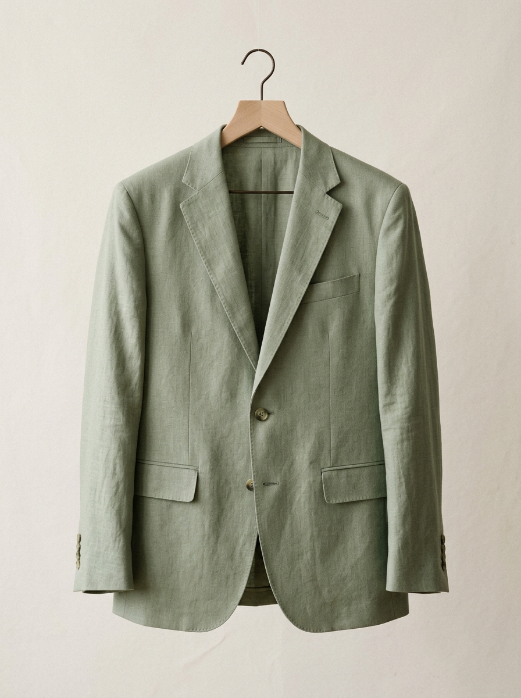
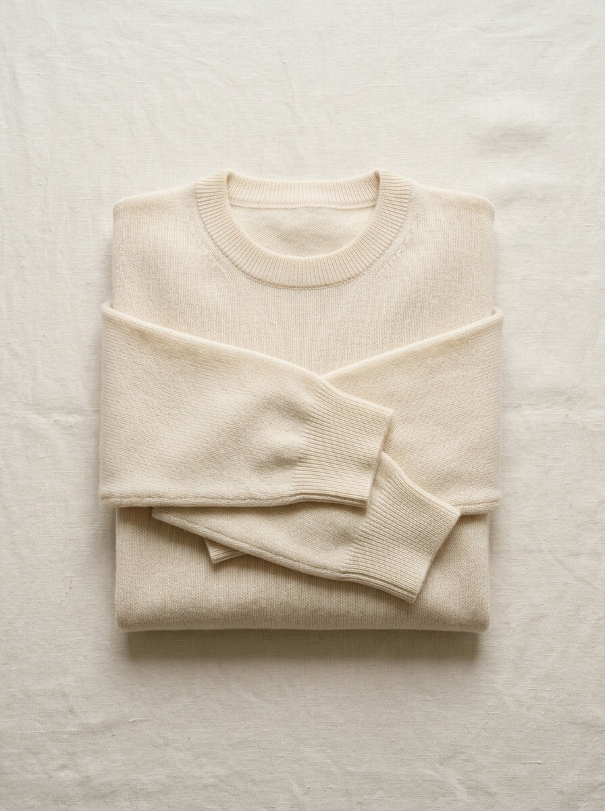
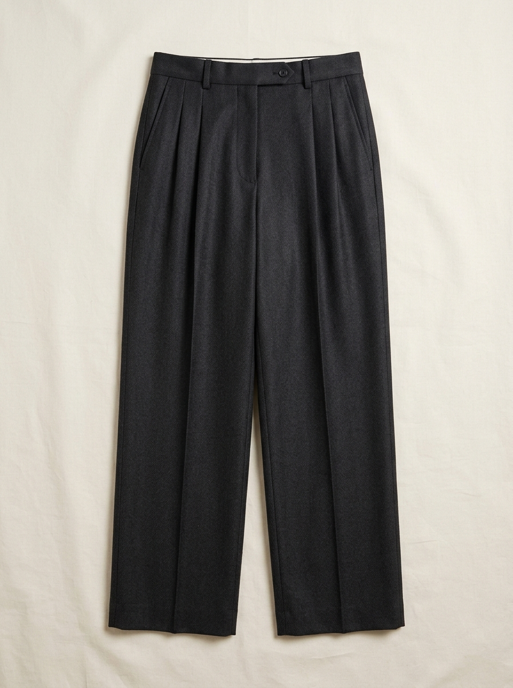
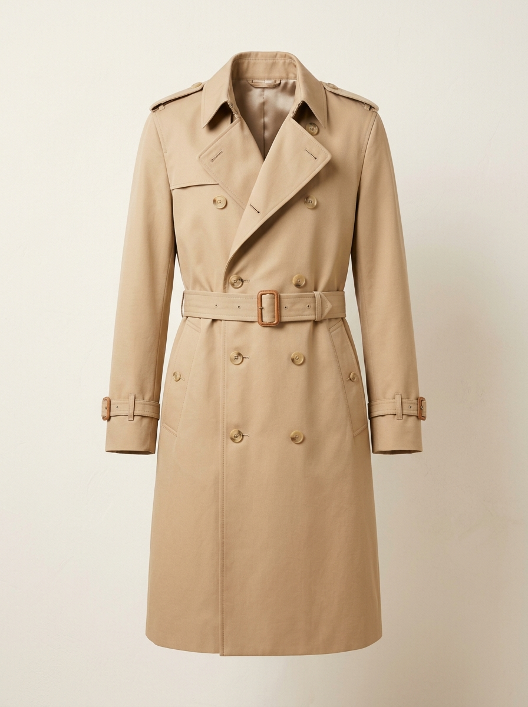

# OutDrobe — The Pocket Wardrobe

<div align="center">


**An architectural digital wardrobe and outfit-planning application designed for mindful curation, intentional dressing, and real-time cost-per-wear analytics.**

[](https://out-drobe.vercel.app/)
[](https://github.com/marufur-rahman-reshat/OutDrobe)
[](https://react.dev/)
[](https://www.typescriptlang.org/)
[](https://vitejs.dev/)
[](https://tailwindcss.com/)
[](https://supabase.com/)

</div>

---

## Table of Contents

1. [Project Title and Introduction](#1-project-title-and-introduction)
2. [Project Overview](#2-project-overview)
3. [Live Demo](#3-live-demo)
4. [Screenshots](#4-screenshots)
5. [Key Features](#5-key-features)
6. [Application Pages and Modules](#6-application-pages-and-modules)
7. [Technology Stack](#7-technology-stack)
8. [System Architecture](#8-system-architecture)
9. [Database Architecture and Relationships](#9-database-architecture-and-relationships)
10. [Authentication and Authorization](#10-authentication-and-authorization)
11. [Image Upload and Storage Architecture](#11-image-upload-and-storage-architecture)
12. [Project Folder Structure](#12-project-folder-structure)
13. [Installation and Local Development Setup](#13-installation-and-local-development-setup)
14. [Environment Variables](#14-environment-variables)
15. [Supabase Configuration](#15-supabase-configuration)
16. [Deployment Guide (GitHub and Vercel)](#16-deployment-guide-github-and-vercel)
17. [Security Considerations](#17-security-considerations)
18. [Current Project Status](#18-current-project-status)
19. [Future Improvements](#19-future-improvements)
20. [Author Information](#20-author-information)
21. [Acknowledgements](#21-acknowledgements)

---

## 1. Project Title and Introduction

**OutDrobe — The Pocket Wardrobe** is a full-stack personal digital wardrobe and lookbook application. It bridges personal fashion with data-driven wardrobe stewardship by digitizing physical clothing collections, tracking garment usage, composing multi-layer looks in an interactive builder, planning calendar outfits, and computing cost-per-wear (CPW) metrics.

Built on React 19, TypeScript, and Tailwind CSS 4, OutDrobe interfaces directly with Supabase Cloud services—leveraging Supabase Auth for identity management, PostgreSQL with Row Level Security (RLS) for data persistence, and a private Supabase Storage bucket with signed URL generation for secure photo management.

---

## 2. Project Overview

Modern closets frequently suffer from decision fatigue, neglected clothing items, and uncoordinated impulse purchases. OutDrobe treats clothing curation as personal architecture, giving users total visibility over their wardrobe inventory and usage history.

### The Problem
- **Wardrobe Decision Fatigue:** Users spend unnecessary time choosing daily outfits without clear visibility into what pieces work together.
- **Low Garment Utilization:** A small fraction of a closet is worn repeatedly, while valuable pieces sit idle and forgotten.
- **Hidden Cost of Fast Fashion:** Without cost-per-wear tracking, users cannot evaluate the true economic and ecological value of their garments.

### The OutDrobe Solution
- **Visual Closet Digitization:** Catalog individual garments with categories, colors, fabrics, seasons, prices, and high-resolution photos.
- **Interactive Outfit Composition:** Layer pieces across categories (`Outerwear`, `Tops`, `Bottoms`, `Footwear`, `Accessories`) to compose and test ensembles before dressing.
- **Complete Lookbook Management:** Save, edit, tag, and organize outfit ensembles for various occasions (`Daily Studio`, `Professional`, `Campus`, `Evening`, `Weekend`, `Travel`).
- **One-Click Wear Logging:** Record daily wear events that automatically increment wear counts and update `last_worn_date` across both the outfit and every constituent garment piece.
- **Quantitative Closet Health:** Inspect financial return on investment through real-time cost-per-wear analytics (`purchasePrice / wearCount`), category allocations, and wear rotation alerts.
- **Scheduled Outfit Planning:** Assign planned looks to upcoming calendar dates and mark them complete upon wearing.

### Design Philosophy
- **Warm Editorial Aesthetic:** A deliberate departure from cold, generic dashboards. Styled in warm parchment tones (`#FAF8F5`, `#F2EFE9`), botanical forest greens (`#526B56`), deep ink typography (`#1C1D1A`), and subtle warm borders (`#E5E0D8`).
- **Zero-Pill Minimalist UI:** Employs structured rectangular cards, clean borders, generous whitespace, and tabular layouts over decorative pills and badges.
- **Sophisticated Typography Pairing:** Combines `Cormorant Garamond` (editorial serif for headlines), `Plus Jakarta Sans` (clean sans-serif for UI labels and body copy), and `IBM Plex Mono` (monospace for figures, metadata, and analytics).
- **Privacy by Default:** Multi-tenant security enforced at the database kernel level through PostgreSQL Row Level Security (RLS) policies and private, folder-isolated cloud storage.

---

## 3. Live Demo

The production application is continuously deployed on Vercel:

- **Live Application:** [https://out-drobe.vercel.app/](https://out-drobe.vercel.app/)
- **Source Code Repository:** [https://github.com/marufur-rahman-reshat/OutDrobe](https://github.com/marufur-rahman-reshat/OutDrobe)

Users can immediately register a new personal account using email and password to begin cataloging garments, building outfits, and logging wear events.

---

## 4. Screenshots

| View / Module | Visual Preview | Description |
|---|---|---|
| **Editorial Dashboard** |  | High-level closet overview displaying today's scheduled look, closet valuation KPIs, and fast wear-logging shortcuts. |
| **Digital Wardrobe Catalog** |  | Filterable garment archive showing category tabs, seasonal filters, color swatches, wear counters, and cost-per-wear indicators. |
| **Interactive Outfit Builder** |  | Visual layer composer supporting Outerwear, Tops, Bottoms, Footwear, and Accessories, complete with capsule shuffle and live look updates. |
| **Saved Lookbook** |  | Curated collection of styled looks featuring 2x2 photo collages, occasion filters, pencil edit actions, wear logs, and calendar scheduling. |
| **Outfit Planning Calendar** |  | Date-based outfit scheduling allowing users to assign ensembles to upcoming dates and mark them complete as worn. |
| **Wardrobe Analytics & CPW** |  | Financial and utilization metrics breaking down total wardrobe expenditure, best-value garments, and rotation recommendations. |

---

## 5. Key Features

- **Full Wardrobe Cataloging:** Add garments with name, brand, category, fabric, color, hex swatch, season, purchase price, and notes. Choose from built-in studio presets or upload device photos.
- **Client-Side Image Optimization:** Automatically resizes and compresses user-uploaded photos via HTML5 Canvas before network transmission, keeping file sizes small while maintaining crisp quality.
- **Private Cloud Storage:** Stores binary images inside a dedicated, private Supabase Storage bucket (`clothing-images`) strictly organized in user-scoped directories (`<user-id>/<file-uuid>.jpg`).
- **Expiring Signed URLs:** Fetches on-demand 24-hour signed URLs in batches, rendering private bucket images without exposing public read URLs or credentials.
- **Visual Layer Composer:** Select one garment per layer (`Outerwear`, `Tops`, `Bottoms`, `Footwear`, `Accessories`) to compose balanced silhouettes with color harmony and pricing feedback.
- **Saved Outfit Edit Mode:** Edit existing saved ensembles in-place via the Lookbook pencil button. Prefills all layers, metadata, and styling notes with an **"Update Look"** action, preventing duplicate outfit creation.
- **Normalized Relational Outfits:** Normalizes outfits into parent `public.outfits` rows and individual junction rows in `public.outfit_items` for relational integrity.
- **Atomic Wear Logger:** Log outfit wears with dates, occasion tags, and weather notes. Automatically increments cumulative wear counts and updates `last_worn_date` on both the outfit and each individual piece.
- **Real-Time Cost-per-Wear (CPW):** Continuously calculates `purchasePrice / wearCount` to demonstrate garment value over time and identify underutilized clothing.
- **Date-Based Outfit Calendar:** Schedule planned looks for specific calendar days, track upcoming plans, and mark events complete upon wear.
- **Context-Aware Suggestions:** Rule-based styling engine offering seasonal and occasion-tailored recommendations that promote balanced closet rotation.
- **Closet Health & Utilization Analytics:** Real-time metrics highlighting archive valuation, utilization percentages, top value pieces, and neglected garments.

---

## 6. Application Pages and Modules

The OutDrobe workspace consists of ten specialized modules and public onboarding screens:

```
OutDrobe Application Structure
├── Public Onboarding
│   ├── Landing Page (Editorial showcase, features, and call-to-action)
│   └── Auth Modal (Email/password login & registration)
│
└── Authenticated Workspace Shell (App.tsx)
    ├── 1. Dashboard (Closet health overview, today's outfit, quick logging)
    ├── 2. Digital Wardrobe (Garment catalog, category filtering, add/edit modal)
    ├── 3. Outfit Builder (Multi-layer composer, shuffle capsule, look updater)
    ├── 4. Saved Outfits (Lookbook gallery, occasion filters, edit/delete/log/schedule)
    ├── 5. Favorite Outfits (Curated view of starred, high-confidence ensembles)
    ├── 6. Outfit Calendar (Monthly planning calendar with date assignments)
    ├── 7. Wear History (Chronological diary of wear logs, weather, and occasion tags)
    ├── 8. Suggestions (Contextual pairing engine based on climate and occasion)
    ├── 9. Statistics (Expenditure breakdown, cost-per-wear charts, piece rotation)
    └── 10. System Blueprint (Interactive engineering and architectural specification)
```

### Module Breakdown

1. **Dashboard (`DashboardView.tsx`):** Displays central KPIs (total garments, active looks, unworn piece count, total closet valuation, average CPW). Highlights today's scheduled look from the calendar with an immediate wear-logging action.
2. **Digital Wardrobe (`WardrobeView.tsx`):** The primary garment catalog. Features category tabs (`All`, `Outerwear`, `Tops`, `Bottoms`, `Footwear`, `Accessories`), season filtering, color swatches, favorite toggling, and a full cataloging modal with photo upload and studio fallback presets.
3. **Outfit Builder (`OutfitBuilderView.tsx`):** The visual ensemble studio. Allows users to select items across category layers, preview silhouette balance, shuffle combinations, and either save a new ensemble or update an existing look with prefilled state and a cancel option.
4. **Saved Outfits / Lookbook (`OutfitsView.tsx`):** Displays 2x2 grid preview cards of assembled outfits. Provides occasion filtering, a subtle pencil button to trigger the builder in edit mode, a delete button, a wear-logger button, and a calendar scheduling modal.
5. **Favorite Outfits (`OutfitsView.tsx` with `favoritesOnly={true}`):** Filters the Lookbook to isolate starred, go-to ensembles for rapid selection and scheduling.
6. **Outfit Calendar (`CalendarView.tsx`):** A calendar planner that enables users to schedule outfits for specific calendar dates, attach occasion notes, view planned pieces, and mark items complete as they are worn.
7. **Wear History (`WearHistoryView.tsx`):** A chronological diary of wear events showing dates, associated outfits, piece thumbnails, weather conditions, and personal notes.
8. **Suggestions Engine (`SuggestionsView.tsx`):** Algorithmic styling assistant that analyzes wardrobe inventory and recommends harmonious combinations for specific weather conditions and occasions while activating least-worn pieces.
9. **Statistics & Analytics (`StatisticsView.tsx`):** Detailed metrics covering expenditure by category, color palette distributions, top 5 best-value garments (lowest cost-per-wear), and least-worn pieces needing rotation.
10. **System Blueprint (`BlueprintView.tsx`):** An embedded technical specification detailing system requirements, data flow, database schemas, and engineering standards.

---

## 7. Technology Stack

### Frontend
- **Framework:** [React 19](https://react.dev/) — Functional components, custom hooks, `useMemo`, and `useCallback` for optimized rendering.
- **Language:** [TypeScript 5.x](https://www.typescriptlang.org/) — Strict type checking with comprehensive domain models.
- **Build Tool:** [Vite 8](https://vitejs.dev/) — Fast development server and optimized ESM production bundling.
- **Styling:** [Tailwind CSS 4](https://tailwindcss.com/) — Utility-first styling with native CSS variables and editorial palette configuration.
- **Icons:** [Lucide React](https://lucide.dev/) — Lightweight, accessible SVG iconography.
- **Animation:** [Motion](https://motion.dev/) — Subtle transitions and drawer micro-interactions.

### Backend & Cloud Infrastructure (Supabase)
- **Database:** [Supabase Managed PostgreSQL](https://supabase.com/) with kernel-level Row Level Security (RLS).
- **Authentication:** [Supabase Auth (GoTrue)](https://supabase.com/auth) — Email and password authentication with client-side JWT session persistence.
- **Object Storage:** [Supabase Storage](https://supabase.com/storage) — Private `clothing-images` bucket with user-folder RLS and expiring signed URLs.
- **Data Access:** `@supabase/supabase-js` — Official TypeScript client using publishable keys and active user session tokens.

### Hosting & DevOps
- **Deployment Platform:** [Vercel](https://vercel.com/) — Automated Git integration, edge network hosting, and environment variable configuration.
- **Development Environment:** Google AI Studio Build — AI-assisted software engineering and iterative development environment.

---

## 8. System Architecture

OutDrobe follows a **Component-Based React Architecture with a Centralized API Service Layer and Supabase Backend**. Components do not issue direct database queries; all data access, authentication, image optimization, and URL resolution flow through dedicated services in `src/services/`.

```
┌─────────────────────────────────────────────────────────────────────────────┐
│                       React 19 Client Application (SPA)                     │
│                                                                             │
│   ┌─────────────────────────────────────────────────────────────────────┐   │
│   │ App.tsx (Workspace State, Session Bootstrap, Active Navigation)     │   │
│   └───────────────┬─────────────────────────────────┬───────────────────┘   │
│                   │                                 │                       │
│                   ▼                                 ▼                       │
│   ┌──────────────────────────────┐   ┌──────────────────────────────────┐   │
│   │ View Modules (10 Views)      │   │ Common Components                │   │
│   │ Wardrobe, Builder, Outfits...│   │ ClothingCard, OutfitCard, Image  │   │
│   └───────────────┬──────────────┘   └──────────────────┬───────────────┘   │
│                   │                                     │                   │
│                   ▼                                     ▼                   │
│   ┌─────────────────────────────────────────────────────────────────────┐   │
│   │ Centralized Service Layer                                           │   │
│   │  • src/services/api.ts (outdrobeApi: CRUD, data mapping, hydration) │   │
│   │  • src/services/storageService.ts (upload, batch signed URLs, purge)│   │
│   │  • src/lib/supabaseClient.ts (authenticated client initialization)  │   │
│   └──────────────────────────────────┬──────────────────────────────────┘   │
└──────────────────────────────────────┼──────────────────────────────────────┘
                                       │ HTTPS / Client JWT (Bearer)
                                       ▼
┌─────────────────────────────────────────────────────────────────────────────┐
│                        Supabase Managed Cloud Platform                      │
│                                                                             │
│   ┌─────────────────────────────────────────────────────────────────────┐   │
│   │ Supabase Auth (GoTrue)                                              │   │
│   │ Validates credentials, issues JWT containing authenticated auth.uid │   │
│   └──────────────────────────────────┬──────────────────────────────────┘   │
│                                      │                                      │
│                   ┌──────────────────┴──────────────────┐                   │
│                   ▼                                     ▼                   │
│   ┌─────────────────────────────────┐   ┌───────────────────────────────┐   │
│   │ Supabase PostgreSQL (PostgREST) │   │ Supabase Storage              │   │
│   │ Enforces RLS policies on:       │   │ Private "clothing-images"     │   │
│   │  • profiles                     │   │ Objects scoped to:            │   │
│   │  • clothing_items               │   │  /<user-id>/<uuid>.jpg        │   │
│   │  • outfits                      │   │ Authenticated read access via │   │
│   │  • outfit_items (junction)      │   │ 24-hour signed URLs           │   │
│   │  • calendar_plans               │   └───────────────────────────────┘   │
│   │  • wear_logs                    │                                       │
│   └─────────────────────────────────┘                                       │
└─────────────────────────────────────────────────────────────────────────────┘
```

### Data Flow Lifecycle

1. **Bootstrap & Hydration:** On application load, `App.tsx` checks for an existing session token. If found, it fetches the current profile via `outdrobeApi.getCurrentUser()` and executes `getWorkspace()` to fetch wardrobe items, outfits, calendar plans, and wear logs in parallel.
2. **Batch Signed URL Resolution:** During workspace hydration, all private storage object paths are gathered into a single array and resolved via `getBatchSignedGarmentUrls()`, mapping each storage path to an active 24-hour signed URL in a single network round-trip.
3. **Atomic Mutations:** Operations such as logging wear execute coordinated database updates—incrementing wear counts and updating `last_worn_date` on the outfit and constituent garments before inserting a record into `wear_logs` and returning a fresh workspace snapshot.

---

## 9. Database Architecture and Relationships

OutDrobe utilizes six relational tables in the `public` schema of Supabase PostgreSQL. All tables enforce primary keys, foreign key constraints, and user ownership scoping.

```
                  ┌──────────────────────┐
                  │    auth.users (1)    │
                  └──────────┬───────────┘
                             │
     ┌──────────────┬────────┼──────────────┬──────────────┐
     │ 1:1          │ 1:N    │ 1:N          │ 1:N          │ 1:N
     ▼              ▼        ▼              ▼              ▼
┌──────────┐ ┌────────────┐ ┌────────┐ ┌──────────────┐ ┌───────────┐
│ profiles │ │clothing_   │ │outfits │ │calendar_     │ │wear_logs  │
│          │ │items       │ │        │ │plans         │ │           │
└──────────┘ └─────┬──────┘ └───┬────┘ └──────────────┘ └───────────┘
                   │            │
                   │ 1:N        │ 1:N
                   ▼            ▼
             ┌────────────────────────┐
             │ outfit_items (Junction)│
             └────────────────────────┘
```

### 1. `public.profiles`
Stores profile settings tied directly to the authenticated user ID.

| Column | Type | Constraints | Description |
|---|---|---|---|
| `id` | `uuid` | Primary Key, References `auth.users(id)` ON DELETE CASCADE | Unique user identifier |
| `email` | `text` | Not Null | User email address |
| `display_name` | `text` | Nullable | User display name |
| `style_note` | `text` | Nullable | Personal style motto or capsule goal |
| `created_at` | `timestamptz` | Default `now()` | Record creation timestamp |

### 2. `public.clothing_items`
Contains the individual physical wardrobe garments cataloged by the user.

| Column | Type | Constraints | Description |
|---|---|---|---|
| `id` | `uuid` | Primary Key, Default `gen_random_uuid()` | Unique garment record ID |
| `user_id` | `uuid` | References `auth.users(id)` ON DELETE CASCADE | Owner user identifier |
| `name` | `text` | Not Null | Name of the garment |
| `brand` | `text` | Default `'Personal Archive'` | Brand or designer |
| `category` | `text` | Not Null | Category (`Outerwear`, `Tops`, `Bottoms`, `Footwear`, `Accessories`) |
| `color` | `text` | Default `'Neutral'` | Primary color name |
| `color_hex` | `text` | Default `'#8C8A82'` | Hexadecimal color code for swatch display |
| `fabric` | `text` | Default `'Natural Fiber'` | Fabric composition (e.g., "100% Cotton") |
| `season` | `text` | Default `'All Seasons'` | Season tag (`All Seasons`, `Spring`, `Summer`, `Autumn`, `Winter`) |
| `purchase_price` | `numeric` | Default `0` | Original purchase price |
| `image_key` | `text` | Default `'sage_blazer'` | Preset lookbook identifier fallback |
| `image_url` | `text` | Nullable | Relative private storage path (`<user-id>/<uuid>.jpg`) |
| `wear_count` | `integer` | Default `0` | Number of times this garment has been worn |
| `last_worn_date` | `text` | Nullable | Date string (`YYYY-MM-DD`) when last worn |
| `is_favorite` | `boolean` | Default `false` | Favorite status |
| `notes` | `text` | Nullable | Care, fit, or tailoring notes |
| `created_at` | `timestamptz` | Default `now()` | Record creation timestamp |

### 3. `public.outfits`
Stores composed outfit combinations and styling metadata.

| Column | Type | Constraints | Description |
|---|---|---|---|
| `id` | `uuid` | Primary Key, Default `gen_random_uuid()` | Unique outfit record ID |
| `user_id` | `uuid` | References `auth.users(id)` ON DELETE CASCADE | Owner user identifier |
| `name` | `text` | Not Null | Outfit name |
| `occasion` | `text` | Default `'Daily Studio'` | Occasion classification |
| `season` | `text` | Default `'All Seasons'` | Season classification |
| `is_favorite` | `boolean` | Default `false` | Favorite status |
| `wear_count` | `integer` | Default `0` | Number of times this outfit has been worn |
| `last_worn_date` | `text` | Nullable | Date string (`YYYY-MM-DD`) when last worn |
| `notes` | `text` | Nullable | Styling notes and ensemble advice |
| `created_at` | `timestamptz` | Default `now()` | Record creation timestamp |

### 4. `public.outfit_items` (Junction Table)
Implements the normalized Many-to-Many relationship between `outfits` and `clothing_items`.

| Column | Type | Constraints | Description |
|---|---|---|---|
| `id` | `uuid` | Primary Key, Default `gen_random_uuid()` | Unique junction record ID |
| `outfit_id` | `uuid` | Foreign Key → `public.outfits(id)` ON DELETE CASCADE | Associated outfit ID |
| `clothing_item_id` | `uuid` | Foreign Key → `public.clothing_items(id)` ON DELETE CASCADE | Associated garment ID |
| `user_id` | `uuid` | References `auth.users(id)` ON DELETE CASCADE | Owner UUID for direct RLS enforcement |
| `created_at` | `timestamptz` | Default `now()` | Record creation timestamp |

### 5. `public.calendar_plans`
Stores scheduled outfits assigned to calendar dates.

| Column | Type | Constraints | Description |
|---|---|---|---|
| `id` | `uuid` | Primary Key, Default `gen_random_uuid()` | Unique calendar plan ID |
| `user_id` | `uuid` | References `auth.users(id)` ON DELETE CASCADE | Owner user identifier |
| `date` | `text` | Not Null | Target planning date (`YYYY-MM-DD`) |
| `outfit_id` | `uuid` | Foreign Key → `public.outfits(id)` ON DELETE CASCADE | Scheduled outfit ID |
| `occasion_note` | `text` | Nullable | Specific occasion note for the date |
| `is_completed` | `boolean` | Default `false` | Status indicating if the outfit was worn |
| `created_at` | `timestamptz` | Default `now()` | Record creation timestamp |

### 6. `public.wear_logs`
Chronicles wear events and journal entries.

| Column | Type | Constraints | Description |
|---|---|---|---|
| `id` | `uuid` | Primary Key, Default `gen_random_uuid()` | Unique wear log ID |
| `user_id` | `uuid` | References `auth.users(id)` ON DELETE CASCADE | Owner user identifier |
| `date` | `text` | Not Null | Date worn (`YYYY-MM-DD`) |
| `outfit_id` | `uuid` | Nullable, References `public.outfits(id)` ON DELETE SET NULL | Associated outfit ID |
| `outfit_name` | `text` | Not Null | Snapshot name of the outfit at log time |
| `item_ids` | `text[]` | Default `'{}'` | Array of garment UUIDs included in the wear |
| `occasion` | `text` | Nullable | Occasion tag for the wear event |
| `weather_note` | `text` | Nullable | Climate or weather note (e.g., "17°C · Mild") |
| `notes` | `text` | Nullable | Personal wear reflection notes |
| `created_at` | `timestamptz` | Default `now()` | Record creation timestamp |

---

## 10. Authentication and Authorization

- **Provider:** Supabase Auth (GoTrue engine) via email and password.
- **Client Session Management:** The client uses `@supabase/supabase-js` configured with `persistSession: true`, `autoRefreshToken: true`, and `detectSessionInUrl: true`.
- **Identity Scoping:** Upon registration or sign-in, Supabase returns a secure JSON Web Token (JWT) with the user's unique identifier (`sub` claim). The client passes this token automatically in request headers.
- **Strict User Scoping:** The application never passes user IDs from form inputs or client-side trust assumptions. All insert and update payloads derive ownership strictly from `supabase.auth.getUser()`, and all PostgreSQL queries are bounded by Row Level Security (`auth.uid() = user_id`).
- **No Third-Party OAuth:** The application does not use external social login providers or third-party OAuth redirect flows, keeping authentication lightweight and self-contained.

---

## 11. Image Upload and Storage Architecture

OutDrobe implements a privacy-first, secure storage architecture for user garment photographs:

```
[ User Selects Image ]
          │
          ▼
[ HTML5 Canvas Pre-Processing ]
• Resizes image to a max boundary of 900x900px
• Compresses to high-quality JPEG (quality: 0.84)
• Converts Base64 Data URL to binary Blob
          │
          ▼
[ storageService.uploadGarmentImage() ]
• Obtains authenticated user.id from active session
• Generates secure user-scoped path: <user-id>/<crypto-uuid>.jpg
• Uploads binary Blob to private bucket: "clothing-images"
• Returns relative storage path: "<user-id>/<crypto-uuid>.jpg"
          │
          ▼
[ Database Persistence ]
• clothing_items.image_url stores ONLY the relative path ("<user-id>/<crypto-uuid>.jpg")
• NEVER persists massive Base64 strings or temporary URLs in PostgreSQL
          │
          ▼
[ Batch Signed URL Resolution ]
• During getWorkspace(), all storage paths are collected
• storageService.getBatchSignedGarmentUrls() requests 24h signed URLs in one call
• <GarmentImage /> renders signed URL with automatic studio preset fallback
```

### Safe Storage Lifecycle Operations
1. **Insert Rollback Protection:** If database insertion fails after a photo has been uploaded to storage, `storageService.deleteGarmentImage()` automatically purges the newly uploaded file to prevent orphaned storage objects.
2. **Safe Photo Replacement:** When a user replaces a garment's photo, the new image is uploaded and the database row is updated first. Only after the database update succeeds is the old storage object deleted.
3. **Cascading Garment Deletion:** Deleting a garment removes its database row and subsequently purges its associated image from the private storage bucket.

---

## 12. Project Folder Structure

```
OutDrobe/
├── .env.example                     # Environment variables template
├── index.html                       # HTML5 entry point with typography links
├── package.json                     # Dependencies, scripts, and project metadata
├── tsconfig.json                    # TypeScript compiler configuration
├── vite.config.ts                   # Vite configuration with Tailwind CSS plugin
│
├── public/                          # Static public web assets
│   └── favicon.ico
│
└── src/
    ├── App.tsx                      # Root component: state, navigation, modal routing
    ├── main.tsx                     # Application bootstrap and React DOM mount
    ├── index.css                    # Tailwind CSS 4 directives and font tokens
    ├── vite-env.d.ts                # Vite environment type declarations
    │
    ├── assets/
    │   └── images/                  # Built-in high-resolution studio garment assets
    │       ├── garment_camel_trench_*.jpg
    │       ├── garment_charcoal_trousers_*.jpg
    │       ├── garment_ivory_knit_*.jpg
    │       ├── garment_leather_loafers_*.jpg
    │       ├── garment_sage_blazer_*.jpg
    │       └── hero_minimalist_wardrobe_*.jpg
    │
    ├── components/
    │   ├── auth/
    │   │   └── AuthModal.tsx        # Sign-in and registration modal
    │   │
    │   ├── common/
    │   │   ├── ClothingCard.tsx     # Garment card with wear count and CPW metrics
    │   │   ├── GarmentImage.tsx     # Image component with fallback handling
    │   │   └── OutfitCard.tsx       # Outfit card with 2x2 collage, edit, and wear actions
    │   │
    │   ├── landing/
    │   │   └── LandingPage.tsx      # Public landing page with feature showcase
    │   │
    │   └── modules/
    │       ├── BlueprintView.tsx    # Interactive architectural blueprint
    │       ├── CalendarView.tsx     # Scheduled outfit calendar planner
    │       ├── DashboardView.tsx    # Closet health KPIs and today's look
    │       ├── OutfitBuilderView.tsx# Lookbook studio for layer composition and edits
    │       ├── OutfitsView.tsx      # Saved outfits gallery and occasion filters
    │       ├── StatisticsView.tsx   # Wardrobe expenditure and CPW analytics
    │       ├── SuggestionsView.tsx  # Climate and occasion outfit suggestions
    │       ├── WardrobeView.tsx     # Garment archive with add/edit modal
    │       └── WearHistoryView.tsx  # Chronological wear journal and diary
    │
    ├── data/
    │   ├── architectureSpec.ts      # Architectural specifications data
    │   └── garmentAssets.ts         # Lookbook preset definitions and metadata
    │
    ├── lib/
    │   └── supabaseClient.ts        # Supabase client instance and config validation
    │
    ├── services/
    │   ├── api.ts                   # Centralized outdrobeApi service (PostgREST queries)
    │   └── storageService.ts        # Storage service (uploads, batch signed URLs, purge)
    │
    └── types/
        └── outdrobe.ts              # TypeScript interfaces and domain type definitions
```

---

## 13. Installation and Local Development Setup

### Prerequisites
- **Node.js:** Version 18.x, 20.x, or 22.x installed.
- **npm:** Version 9.x or higher.
- **Supabase Account:** A free Supabase project with PostgreSQL, Auth, and Storage enabled.

### Step-by-Step Setup

1. **Clone the repository:**
   ```bash
   git clone https://github.com/marufur-rahman-reshat/OutDrobe.git
   cd OutDrobe
   ```

2. **Install project dependencies:**
   ```bash
   npm install
   ```

3. **Configure environment variables:**
   Create a `.env` file in the project root:
   ```bash
   touch .env
   ```
   Add your Supabase project credentials as detailed in [Environment Variables](#14-environment-variables).

4. **Set up the database tables and storage bucket:**
   Execute the schema SQL in your Supabase SQL Editor (see [Supabase Configuration](#15-supabase-configuration)).

5. **Start the local development server:**
   ```bash
   npm run dev
   ```
   The development server will start at `http://localhost:3000/`.

6. **Validate TypeScript types and build:**
   ```bash
   # Type check
   npm run lint

   # Production build
   npm run build
   ```

---

## 14. Environment Variables

OutDrobe requires your Supabase project URL and publishable anonymous API key. The client-side application detects these variables through standard Vite environment prefixes or runtime fallbacks.

Create a `.env` file in the root directory and populate it with your project credentials:

```ini
# .env

# Standard Vite configuration (Recommended for local dev and Vercel)
# Found in your Supabase Dashboard under Project Settings -> API
VITE_SUPABASE_URL="https://your-project-id.supabase.co"
VITE_SUPABASE_ANON_KEY="your-supabase-publishable-anon-key"
```

### Canonical Variable Aliases
The application also supports the following canonical environment variable aliases (recognized by the build define mapping in `vite.config.ts` and the runtime diagnostics in `src/lib/supabaseClient.ts`):

```ini
SUPABASE_URL="https://your-project-id.supabase.co"
SUPABASE_PUBLISHABLE_KEY="your-supabase-publishable-anon-key"
```

> **Security Note:** In documentation and public repositories, always use safe placeholder values like those shown above. Provide your actual project credentials only in your private local `.env` file or in your hosting provider's secure environment settings (e.g., Vercel Environment Variables). Never commit your `.env` file, actual API keys, passwords, or secrets to GitHub. Frontend applications must only use client-safe anonymous publishable keys—never expose a Supabase `service_role` key in client-side code.

---

## 15. Supabase Configuration

To set up the required PostgreSQL schema, Row Level Security policies, and Storage bucket for OutDrobe:

### 1. Database Tables and Foreign Keys (SQL)
Run the following SQL in your Supabase project's **SQL Editor**:

```sql
-- 1. Profiles Table
CREATE TABLE public.profiles (
  id uuid PRIMARY KEY REFERENCES auth.users(id) ON DELETE CASCADE,
  email text NOT NULL,
  display_name text,
  style_note text,
  created_at timestamptz DEFAULT now()
);

-- 2. Clothing Items Table
CREATE TABLE public.clothing_items (
  id uuid PRIMARY KEY DEFAULT gen_random_uuid(),
  user_id uuid NOT NULL REFERENCES auth.users(id) ON DELETE CASCADE,
  name text NOT NULL,
  brand text DEFAULT 'Personal Archive',
  category text NOT NULL,
  color text DEFAULT 'Neutral',
  color_hex text DEFAULT '#8C8A82',
  fabric text DEFAULT 'Natural Fiber',
  season text DEFAULT 'All Seasons',
  purchase_price numeric DEFAULT 0,
  image_key text DEFAULT 'sage_blazer',
  image_url text,
  wear_count integer DEFAULT 0,
  last_worn_date text,
  is_favorite boolean DEFAULT false,
  notes text DEFAULT '',
  created_at timestamptz DEFAULT now()
);

-- 3. Outfits Table
CREATE TABLE public.outfits (
  id uuid PRIMARY KEY DEFAULT gen_random_uuid(),
  user_id uuid NOT NULL REFERENCES auth.users(id) ON DELETE CASCADE,
  name text NOT NULL,
  occasion text DEFAULT 'Daily Studio',
  season text DEFAULT 'All Seasons',
  is_favorite boolean DEFAULT false,
  wear_count integer DEFAULT 0,
  last_worn_date text,
  notes text DEFAULT '',
  created_at timestamptz DEFAULT now()
);

-- 4. Outfit Items (Junction Table)
CREATE TABLE public.outfit_items (
  id uuid PRIMARY KEY DEFAULT gen_random_uuid(),
  outfit_id uuid NOT NULL REFERENCES public.outfits(id) ON DELETE CASCADE,
  clothing_item_id uuid NOT NULL REFERENCES public.clothing_items(id) ON DELETE CASCADE,
  user_id uuid NOT NULL REFERENCES auth.users(id) ON DELETE CASCADE,
  created_at timestamptz DEFAULT now()
);

-- 5. Calendar Plans Table
CREATE TABLE public.calendar_plans (
  id uuid PRIMARY KEY DEFAULT gen_random_uuid(),
  user_id uuid NOT NULL REFERENCES auth.users(id) ON DELETE CASCADE,
  date text NOT NULL,
  outfit_id uuid NOT NULL REFERENCES public.outfits(id) ON DELETE CASCADE,
  occasion_note text DEFAULT '',
  is_completed boolean DEFAULT false,
  created_at timestamptz DEFAULT now()
);

-- 6. Wear Logs Table
CREATE TABLE public.wear_logs (
  id uuid PRIMARY KEY DEFAULT gen_random_uuid(),
  user_id uuid NOT NULL REFERENCES auth.users(id) ON DELETE CASCADE,
  date text NOT NULL,
  outfit_id uuid REFERENCES public.outfits(id) ON DELETE SET NULL,
  outfit_name text NOT NULL,
  item_ids text[] DEFAULT '{}',
  occasion text DEFAULT 'Daily Studio',
  weather_note text DEFAULT 'Mild',
  notes text DEFAULT '',
  created_at timestamptz DEFAULT now()
);
```

### 2. Enable Row Level Security (RLS)
Enable RLS and create isolation policies on all six tables:

```sql
-- Enable RLS
ALTER TABLE public.profiles ENABLE ROW LEVEL SECURITY;
ALTER TABLE public.clothing_items ENABLE ROW LEVEL SECURITY;
ALTER TABLE public.outfits ENABLE ROW LEVEL SECURITY;
ALTER TABLE public.outfit_items ENABLE ROW LEVEL SECURITY;
ALTER TABLE public.calendar_plans ENABLE ROW LEVEL SECURITY;
ALTER TABLE public.wear_logs ENABLE ROW LEVEL SECURITY;

-- Profiles Policies
CREATE POLICY "Users can view own profile" ON public.profiles FOR SELECT USING (auth.uid() = id);
CREATE POLICY "Users can insert own profile" ON public.profiles FOR INSERT WITH CHECK (auth.uid() = id);
CREATE POLICY "Users can update own profile" ON public.profiles FOR UPDATE USING (auth.uid() = id);

-- Clothing Items Policies
CREATE POLICY "Users can manage own clothing items" ON public.clothing_items
  FOR ALL USING (auth.uid() = user_id) WITH CHECK (auth.uid() = user_id);

-- Outfits Policies
CREATE POLICY "Users can manage own outfits" ON public.outfits
  FOR ALL USING (auth.uid() = user_id) WITH CHECK (auth.uid() = user_id);

-- Outfit Items Policies
CREATE POLICY "Users can manage own outfit items" ON public.outfit_items
  FOR ALL USING (auth.uid() = user_id) WITH CHECK (auth.uid() = user_id);

-- Calendar Plans Policies
CREATE POLICY "Users can manage own calendar plans" ON public.calendar_plans
  FOR ALL USING (auth.uid() = user_id) WITH CHECK (auth.uid() = user_id);

-- Wear Logs Policies
CREATE POLICY "Users can manage own wear logs" ON public.wear_logs
  FOR ALL USING (auth.uid() = user_id) WITH CHECK (auth.uid() = user_id);
```

### 3. Storage Bucket Configuration
1. In the Supabase Dashboard, navigate to **Storage** and create a new bucket named:
   - **Name:** `clothing-images`
   - **Public bucket:** `false` (Private bucket)
2. Add Storage RLS policies to restrict folder operations to the authenticated user:
   ```sql
   -- Allow users to upload to their own user-id folder
   CREATE POLICY "User uploads to own folder" ON storage.objects
     FOR INSERT WITH CHECK (
       bucket_id = 'clothing-images' AND
       (storage.foldername(name))[1] = auth.uid()::text
     );

   -- Allow users to read from their own user-id folder
   CREATE POLICY "User reads from own folder" ON storage.objects
     FOR SELECT USING (
       bucket_id = 'clothing-images' AND
       (storage.foldername(name))[1] = auth.uid()::text
     );

   -- Allow users to delete from their own user-id folder
   CREATE POLICY "User deletes from own folder" ON storage.objects
     FOR DELETE USING (
       bucket_id = 'clothing-images' AND
       (storage.foldername(name))[1] = auth.uid()::text
     );
   ```

---

## 16. Deployment Guide (GitHub and Vercel)

### Deploying to Vercel

1. **Push your code to GitHub:**
   ```bash
   git add .
   git commit -m "feat: complete OutDrobe production release"
   git push origin main
   ```

2. **Connect to Vercel:**
   - Go to [Vercel](https://vercel.com/) and select **Add New Project**.
   - Import the `marufur-rahman-reshat/OutDrobe` repository.

3. **Configure Project Settings:**
   - **Framework Preset:** `Vite`
   - **Root Directory:** `./`
   - **Build Command:** `npm run build`
   - **Output Directory:** `dist`
   - **Install Command:** `npm install`

4. **Configure Production Environment Variables:**
   Under **Environment Variables**, add:
   - `VITE_SUPABASE_URL`: Your Supabase Project URL
   - `VITE_SUPABASE_ANON_KEY`: Your Supabase publishable anonymous key

5. **Deploy:**
   Click **Deploy**. Vercel will build and publish the application with automatic HTTPS and global CDN caching.

---

## 17. Security Considerations

- **Row Level Security (RLS) Everywhere:** Security is strictly enforced at the database level by PostgreSQL. Even if a user crafts a direct API request attempting to query or modify another user's data, the query returns zero rows or errors.
- **Client-Side Publishing Safety:** The application uses only the Supabase anonymous key (`anon`). The high-privilege `service_role` key is never included in the client codebase or build bundles.
- **Private Storage Bucket:** The `clothing-images` bucket is private. Images are never accessible via raw public URLs; access is granted only through time-limited (24-hour) signed URLs generated on behalf of the authenticated session.
- **Strict Folder Isolation:** The storage service asserts that target deletion paths begin with `${user.id}/` before issuing delete commands, preventing cross-directory file tampering.
- **Input Sanitization:** User strings (garment names, brands, notes, occasion tags) are trimmed and validated before database persistence.

---

## 18. Current Project Status

| Capability / Module | Status | Verification Notes |
|---|---|---|
| **Supabase Authentication** | **Production Ready** | Email/password sign-up, sign-in, session auto-refresh, and logout fully functional. |
| **Profile Management** | **Production Ready** | Synchronizes `public.profiles` with auth metadata; custom display names and style notes. |
| **Garment Cataloging (CRUD)** | **Production Ready** | Create, read, update, and delete garments in `public.clothing_items`. Verified in runtime testing. |
| **Private Image Storage** | **Production Ready** | Client-side compression, upload to `clothing-images`, user-scoped folder paths, and 24h batch signed URLs. |
| **Outfit Builder (Create Mode)** | **Production Ready** | Multi-layer visual composition across all 5 categories with capsule shuffle. |
| **Outfit Builder (Edit Mode)** | **Production Ready** | Pencil edit button on Lookbook cards loads existing ensemble into builder, updating `outfits` and `outfit_items` without duplicates. |
| **Outfit Storage & Linking** | **Production Ready** | Relational `outfits` and `outfit_items` tables with cascade deletion. |
| **Wear Logger & Counters** | **Production Ready** | Atomic increment of wear counts on outfits and items with entry in `public.wear_logs`. |
| **Calendar Scheduling** | **Production Ready** | Date assignment, scheduled plan management, and wear completion in `public.calendar_plans`. |
| **Cost-Per-Wear Analytics** | **Production Ready** | Real-time CPW calculations, category breakdown, and rotation alerts in `StatisticsView`. |
| **Rule-Based Suggestions** | **Production Ready** | Weather- and occasion-aware pairing suggestions promoting underutilized garments. |

---

## 19. Future Improvements

- **Interactive Capsule Wardrobe Challenges:** Guided tracking for minimalist capsule challenges (e.g., Project 333 or 10x10 challenge) with milestone badges.
- **High-Resolution Lookbook PDF Export:** Generate printable, formatted lookbook PDF cards for packing lists, seasonal capsules, or personal styling references.
- **Automated Travel Packing Assistant:** Generate suggested packing checklists tailored to destination trip duration, weather forecasts, and planned calendar outfits.
- **Fabric Care and Maintenance Reminders:** Notify users of dry cleaning, delicate washing, or leather conditioning intervals based on wear frequencies.
- **Advanced Garment Search and Tagging:** Full-text search and multi-tag filtering across custom attributes (e.g., vintage, tailored, formalwear).

---

## 20. Author Information

**Marufur Rahman Reshat**  
Computer Science & Engineering (CSE) Undergraduate Student  
American International University-Bangladesh (AIUB)  

- **GitHub Profile:** [@marufur-rahman-reshat](https://github.com/marufur-rahman-reshat)  
- **Project Repository:** [https://github.com/marufur-rahman-reshat/OutDrobe](https://github.com/marufur-rahman-reshat/OutDrobe)  

---

## 21. Acknowledgements

- **[Google AI Studio Build](https://aistudio.google.com/):** For providing an AI-assisted engineering and rapid prototyping development environment.
- **[Supabase](https://supabase.com/):** For their PostgreSQL database platform, Row Level Security, GoTrue authentication, and Storage services.
- **[Vercel](https://vercel.com/):** For global edge hosting, continuous deployment, and preview infrastructure.
- **[Lucide Icons](https://lucide.dev/):** For their comprehensive and accessible vector icon library.
- **[Google Fonts](https://fonts.google.com/):** For the typography pairing of `Cormorant Garamond`, `Plus Jakarta Sans`, and `IBM Plex Mono`.

---

<div align="center">
  <sub>OutDrobe — Designed and built with intention for modern, mindful wardrobes.</sub>
</div>
